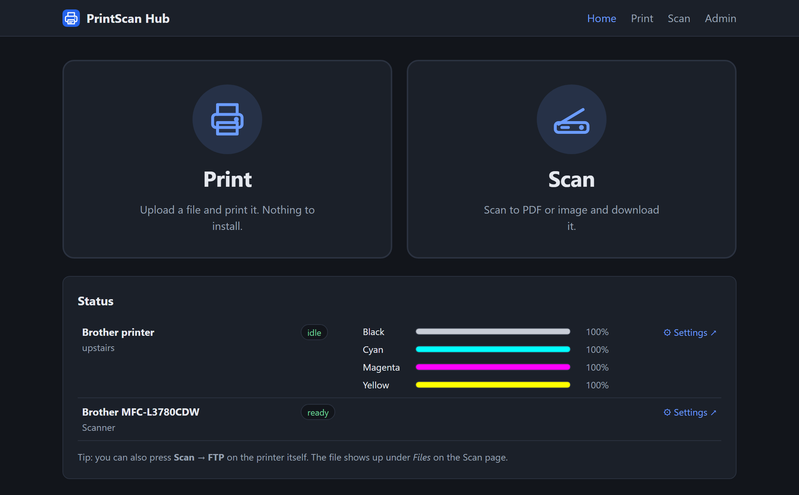

<p align="center">
  
</p>
<h1 align="center">PrintScan Hub</h1>
<p align="center">
  <a href="LICENSE"></a>
  <a href="#quick-start"></a>
  <a href="#tested-hardware"></a>
</p>
<p align="center">
  <strong>One box on your network that holds all the printer and scanner drivers,</strong><br>
  so other computers don't have to install anything.<br>
  Even a locked-down work laptop can print and scan: it's just a website.
</p>

<p align="center">
  
</p>

---

| What | Where | Who |
|---|---|---|
| **Home**: big Print / Scan buttons, toner levels and printer status | `http://<server>/` | anyone on the LAN |
| **Upload & print** from any browser (PDF, images, text, Word/Excel/PowerPoint) | `http://<server>/print` | anyone on the LAN |
| **Scan** to PDF/JPG in the browser, shared or private | `http://<server>/scan` | anyone on the LAN; optional accounts |
| **Scan from the printer's button** into a shared folder | FTP / SMB, see below | the printer |
| **Add as a network printer** without vendor drivers (IPP Everywhere / AirPrint / Mopria) | `http://<server>:631/printers/<queue>` | laptops/phones that are allowed to add printers |
| **Admin**: add printers, install drivers | `http://<server>/admin` | `ADMIN_USER` / `ADMIN_PASSWORD` |
| Full CUPS admin | `http://<server>:631/admin` | same login |

631 is the default; set `CUPS_PORT` in `.env` if that port is taken (see [Linux host prep](#linux-host-prep-why-stop-the-hosts-cups)).

New to printer and scanner jargon (ADF, IPP, eSCL, PPD…)? See [Help: terms explained](#help-terms-explained).

## How it fits together

`docker compose up` starts three containers. The scanner and inbox share the `scans/` folder, so scans the printer sends to the inbox appear on the scan page.

```
      Browsers, laptops and phones on your LAN
      │ :80 portal + scan page  │ :631 IPP
      ▼                         ▼
 ┌──────────────────────────────────┐  ┌───────────────────┐  ┌───────────────────┐
 │ hub                              │  │ scanner           │  │ inbox             │
 │ scan page, private files ────────├─►│ scanservjs        │  │ FTP server        │
 │ web portal ──► CUPS + drivers    │  │ SANE + airscan    │  │ (+ SMB on Linux)  │
 └────────────────┬─────────────────┘  └─────────┬─────────┘  └─────────▲─────────┘
                  │ print (IPP/USB)              │ scan (eSCL)          │ Scan to FTP
                  ▼                              ▼                      │
 ┌──────────────────────────────────────────────────────────────────────┴─────────────┐
 │                              Printer / scanner (MFP)                               │
 └────────────────────────────────────────────────────────────────────────────────────┘
```

| Container | Base image | What runs inside |
|---|---|---|
| **hub** (`printscan-hub`) | Debian 12 (bookworm-slim) | **CUPS** print server and its drivers, the **web portal** (Python/Flask, served by gunicorn, talks to CUPS via pycups), **LibreOffice** to turn Office files into PDF, **Avahi** for printer discovery, the `hub-driver` installer, and the gateway to the scan page that keeps private scans private (SQLite, in `data/portal/`) |
| **scanner** (`printscan-scanner`) | [`sbs20/scanservjs`](https://hub.docker.com/r/sbs20/scanservjs) | **scanservjs** web scanning app on top of **SANE** and **sane-airscan**, plus the hub's additions: driver installer, feeder detection, whole-stack feeder scans, 2-sided (long/short edge), page review before saving, links to View & rotate, Letter default, tooltips (press and hold on touch screens), "Scan now" label |
| **inbox** (`printscan-inbox`) | Alpine 3.20 | **vsftpd** FTP server (and **Samba** on Linux hosts) that saves the printer's own scans into `scans/` |

The scan app isn't reachable on its own port. The portal serves it at `/scan/app/` and shows it inside its **Scan** tab,
so it can decide who sees which scans. Ports above are the defaults; change them in `.env`.

### Built with

PrintScan Hub mostly wires together existing open-source projects. Many thanks to them:

| Project | Used for |
|---|---|
| [CUPS](https://openprinting.github.io/cups/) + [cups-filters](https://github.com/OpenPrinting/cups-filters) | Print server, print queues, IPP sharing, converting documents for printers |
| [OpenPrinting](https://openprinting.github.io/) drivers: Gutenprint, [HPLIP](https://developers.hp.com/hp-linux-imaging-and-printing), Foomatic, `printer-driver-*` | The roughly 17,000 printer drivers included out of the box |
| [scanservjs](https://github.com/sbs20/scanservjs) by [sbs20](https://github.com/sbs20) | The web scanning interface (Scan page) |
| [SANE](http://www.sane-project.org/) + [sane-airscan](https://github.com/alexpevzner/sane-airscan) | Talking to scanners; driver-free network scanning over eSCL/WSD |
| [Flask](https://flask.palletsprojects.com/), [gunicorn](https://gunicorn.org/), [pycups](https://github.com/OpenPrinting/pycups) | The hub's web portal and its connection to CUPS |
| [LibreOffice](https://www.libreoffice.org/) | Printing Word/Excel/PowerPoint files (converted to PDF) |
| [Avahi](https://avahi.org/) | Bonjour/mDNS so printers and scanners can be discovered |
| [vsftpd](https://security.appspot.com/vsftpd.html), [Samba](https://www.samba.org/) | The scan inbox (Scan to FTP / network folder) |
| [Debian](https://www.debian.org/), [Alpine Linux](https://alpinelinux.org/), [Docker Compose](https://docs.docker.com/compose/) | Base images and running everything together |

Each project keeps its own license (see [License](#license)). The hub's own code is the portal (`hub/portal/`), the
entrypoints, `shared/hub-driver`, the scanner add-ons (`scanner/hub-*.js`,
`scanservjs/config/config.local.js`) and the compose files.

## Quick start

Best on a **Linux** host: a Raspberry Pi, mini PC, NAS or VM. The steps below are for Debian, Ubuntu,
Raspberry Pi OS and DietPi; for Fedora, RHEL and others see [non-Debian hosts](#on-fedora-rhel-arch-or-another-non-debian-host).

```bash
git clone https://github.com/kyrlon/printscan-hub.git && cd printscan-hub
scripts/linux-host.sh prepare          # stop the host's CUPS; asks to install Docker, Avahi, ipp-usb (see below)
cp .env.example .env                   # set ADMIN_PASSWORD and HUB_ADDRESS (this machine's LAN IP)
docker compose up -d --build
```

Then open `http://<server>/admin`, click **Scan network & USB for printers**, and press **Add** next to your
printer. Pick its `ipp://` (or *driverless*) entry if it's listed: the driver is then `everywhere`, nothing to
install (works for most printers from the last ~10 years). Click **Add printer**. If the scan only shows an
`lpd://` or `socket://` entry, see [everywhere greyed out?](#everywhere-greyed-out).

### On Fedora, RHEL, Arch or another non-Debian host

The containers are **Debian 12 inside** (`debian:bookworm-slim` for the hub; the scan app's image is
Debian-based too), whatever distribution the host runs. Docker only needs the host's kernel, so the hub
runs the same on Fedora, RHEL, Rocky, Alma, Arch or openSUSE. What that means:

- **Drivers are Debian packages.** Upload a vendor's **`.deb`** download, not its `.rpm`, and
  install extra drivers by their Debian names (`printer-driver-brlaser`, not Fedora's package names). This
  applies on every host, because the drivers live inside the container.
- **`scripts/linux-host.sh prepare` only knows Debian-family hosts.** Do its steps by hand:
  - stop the host's CUPS: `sudo systemctl disable --now cups cups-browsed`
  - install Avahi, and ipp-usb for USB printers: `sudo dnf install avahi ipp-usb` (Fedora/RHEL), then
    `sudo systemctl enable --now avahi-daemon`
  - install Docker from [Docker's instructions for your distro](https://docs.docker.com/engine/install/).
    `scripts/linux-host.sh status` still works anywhere.
- **SELinux** (on by default on Fedora/RHEL) can block the containers from the `data/`, `drivers/` and
  `scans/` folders, which shows up as "permission denied" in `docker compose logs`. Check with
  `getenforce`, and add `:z` to the folder mounts in `docker-compose.yml` (e.g. `./scans:/scans:z`).
- **firewalld** blocks incoming connections by default. Open what you use, e.g.
  `sudo firewall-cmd --permanent --add-service={http,ipp,ftp,samba,mdns} && sudo firewall-cmd --reload`.

These hosts aren't in [Tested hardware](#tested-hardware) yet; if you try one, please add a row.
### Linux host prep: why stop the host's CUPS?

On Linux the hub uses **host networking**, so its CUPS needs port **631** (or your `CUPS_PORT`) on the machine itself.
Desktop installs of Debian, Ubuntu and Raspberry Pi OS usually run their own CUPS there, and the
hub's CUPS can't start while it does. Every printer then lives in the hub instead. The helper script
does this for you:

| Command | What it does |
|---|---|
| `scripts/linux-host.sh status` | Read-only check: host CUPS/Avahi/ipp-usb/Docker, which hub ports are free, USB printers |
| `scripts/linux-host.sh prepare` | Stops and disables the host's `cups`/`cups-browsed`, then asks whether to install whatever is missing: `avahi-daemon`, `ipp-usb` (only for USB printers) and Docker |
| `scripts/linux-host.sh prepare --all` | Same, without questions: installs everything missing. Pick individual ones with `--avahi`, `--ipp-usb`, `--docker` (combine freely), or `--none` to only stop the host's CUPS |
| `scripts/linux-host.sh restore` | Turns the host's CUPS back on (run `docker compose down` first) |
| `scripts/linux-host.sh install-docker` | Installs Docker Engine + Compose from Docker's own repository and adds you to the `docker` group |

The commands that change the system ask for `sudo`. Minimal systems (DietPi, Debian netinst, Ubuntu Server) usually
don't have Avahi installed, so let `prepare` add it. Keep **Avahi** (discovery) running, and **ipp-usb**
if you have a USB printer: the hub uses both. If `prepare` installed Docker, log out and back in before
the `docker compose` step so you can run Docker without `sudo`.

**Port 631 already taken, and you want to keep it that way?** Set `CUPS_PORT` in `.env` (e.g.
`CUPS_PORT=8631`) and run `docker compose up -d`. The hub's CUPS moves to that port and the host's CUPS
can stay. Things that follow automatically:
- AirPrint / Mopria / Windows discovery: they announce the new port.
- The *Add to your computer* addresses on the Print page.
- The *full CUPS admin* link.
- The Docker Desktop port mapping.
- `scripts/linux-host.sh status`.

Printers added **by hand** on laptops need the port in the address, e.g. `http://<server>:8631/printers/<queue>`.
Keep 631 if you can: it's what clients try by default. Running both CUPS servers also means two sets of
printers show up in discovery, so name the hub's queues clearly.

**USB printers on Linux:** most USB printers from the last ~8 years (including all-in-ones) support
*IPP over USB*. `ipp-usb` shares them at `http://localhost:60000`, so the hub can print **and scan**
with no vendor driver. In **Admin → Add a printer**, use the device URI `ipp://localhost:60000/ipp/print`
with the `everywhere` driver. `scripts/linux-host.sh status` shows whether ipp-usb found your printer.
Older USB printers without IPP over USB show up as `usb://…` devices and need a driver from the
*Installing drivers* section.

**Docker Desktop (Windows/macOS)** works for network printers, but USB printers and
auto-discovery don't work (the admin page shows a warning). Containers run inside a
Linux VM that your PC's USB ports and LAN multicast don't reach. Add this line to `.env`
so the hub uses normal port mapping (on macOS, use `:` instead of `;`):

```
COMPOSE_FILE=docker-compose.yml;docker-compose.desktop.yml
```

Network scanners can't be auto-discovered there either, so list yours in `.env`
(most network MFPs support driverless eSCL at `http://<printer-ip>/eSCL`):

```
AIRSCAN_DEVICES=Office_MFC=http://192.168.1.50/eSCL,eSCL
```

On Windows, a USB printer can be passed into the VM with
[usbipd-win](https://github.com/dorssel/usbipd-win) (`usbipd bind` + `usbipd attach --wsl`).
The warning goes away once the container can see a USB bus.

## Installing drivers

### Do you need a driver? Usually not: the `everywhere` driver

`everywhere` is CUPS's built-in driver for **IPP Everywhere**, the standard that lets a computer print
without a model-specific driver. The Add printer form offers it, and picks it, whenever the printer's address is an
IPP one. How it works:

1. When you add the printer, CUPS asks it over IPP what it can do: paper sizes, trays, two-sided,
   color, resolutions and the file formats it accepts.
2. From the answers, CUPS writes the printer's settings file (a PPD), the same thing a vendor driver
   would install, so the options match that exact printer.
3. When you print, CUPS converts the document to a standard format the printer understands
   (PWG Raster, Apple Raster or PDF).

It's the same technology as **AirPrint** and **Mopria**, so a printer that supports either almost
certainly works with `everywhere`. That covers most printers from the last ~10 years. USB printers
on Linux work too, through `ipp-usb`. CUPS itself is moving this way: classic per-model drivers are
being phased out.

**Limits:**
- The printer must answer over IPP when you add it, so use an `ipp://`, `ipps://` or `dnssd://…_ipp…`
  address. `socket://` and `lpd://` addresses can't use it.
- You get the standard features: paper, trays, two-sided, color, quality. Brand-only extras (toner save,
  some finishing options) may need the vendor driver.
- Printers from before about 2013 usually don't support it.

#### everywhere greyed out?

The Driver list only offers `everywhere` for an `ipp://`, `ipps://` or `dnssd://…_ipp…` address, so it's greyed out
while **Device URI** is empty or holds an `lpd://`, `socket://` or `usb://` address. Common case: the host has no
Avahi, so the printer scan only finds the printer's `lpd://` address. Either:

- **Type the printer's IPP address** into Device URI: `ipp://<printer-ip>/ipp/print` works for most printers from
  the last ~10 years, and `everywhere` becomes available. Or install Avahi (`scripts/linux-host.sh prepare --avahi`),
  restart the hub and scan again, so the IPP entry is listed.
- **No IPP at all** (older printers): pick a driver for the model in the Driver list (*Search installed drivers…*).
  **If none is installed for your model, install one first**: see [Finding and installing a driver](#finding-and-installing-a-driver),
  then come back and search again.

**Use a vendor driver instead** for an older printer, a non-IPP connection, or a printer that prints
wrongly with `everywhere` (bad margins, a missing feature you need).

### Finding and installing a driver

The image already has `printer-driver-all`, HPLIP, Gutenprint, Foomatic and the
OpenPrinting PPDs (about 17,000 drivers). Search for yours under **Admin → Add a printer → Driver → Search installed drivers…**
before installing anything.

If your printer isn't covered, there are three ways to add a driver. All three are
**remembered in `drivers/printer/` and re-installed automatically** whenever the
container is rebuilt or updated:

1. **Web upload**: Admin → Drivers → *Upload the printer maker's driver*: a vendor `.deb`, a `.ppd`/`.ppd.gz`, or a `.sh`
   install script.
2. **Debian package**: Admin → Drivers → *Find an open-source driver*, type the make and model, then click
   **Install** next to a matching package marked *not installed*. If you already know the name (e.g.
   `printer-driver-brlaser`), use *Already know the Debian package name?* under it: it looks the names up first and
   shows what each one is before you confirm.
3. **Drop files in the folder**, then click *Re-install all* (or restart the container):

   ```
   drivers/printer/
     apt-packages.txt    one Debian package per line
     debs/               vendor .deb files (Brother, Epson, Canon, Kyocera, Xerox...)
     ppd/                .ppd / .ppd.gz files
     scripts/            *.sh, run once per container (for vendors that ship installers)
   ```

From a shell:

```bash
docker exec printscan-hub hub-driver search brother
docker exec printscan-hub hub-driver apt printer-driver-brlaser
docker exec printscan-hub hub-driver add /drivers/debs/mfcl2710dwpdrv-4.0.0-1.i386.deb
docker exec printscan-hub hub-driver list
```

Notes:
- Download the vendor's **Linux → Debian/Ubuntu (.deb)** package, even if your host runs Fedora or RHEL:
  the drivers are installed inside the hub's Debian container, so `.rpm` packages don't apply. i386-only packages (common for
  Brother) are handled: 32-bit support is switched on automatically.
- The hub runs Debian 12 on whatever CPU your host has. On a Raspberry Pi or other ARM board
  (`armhf` or `arm64`), vendor packages built for x86 (`i386`/`amd64`, which includes most Brother,
  Canon and Epson downloads) can't run. The hub refuses them with a message instead of installing a
  driver that would fail on every job. Use `everywhere` or the open-source drivers
  (`printer-driver-*`, `hplip`) there.
- Search results and install results appear right in the Drivers section (full output folded underneath). Each
  install is logged to `drivers/printer/install.log`: read it under **Install log** on the admin page, or via
  *Open install log in new tab* after an install.

### Scanner drivers

Most network scanners from the last ~8 years work with no driver through eSCL/AirScan
(`sane-airscan` is included). For others, use `drivers/scanner/` the same way
(`apt-packages.txt`, `debs/` e.g. Brother `brscan4`, `scripts/`) and run
`docker compose restart scanner`. If a network scanner isn't detected, set
`SANED_NET_HOSTS`, `AIRSCAN_DEVICES` or `PIXMA_HOSTS` in `.env`.

## How scanning works

```
Browser ──► hub portal (/scan/app/) ──► scanservjs ──► scanimage (SANE) ──► backends ──► scanner
             hides others' private      web UI + API    the scanning tool    airscan, USB, hpaio…
             files
```

- **scanservjs** is a small Node.js web app. It doesn't talk to scanners itself: it runs SANE's
  `scanimage` to list scanners, read their options and scan.
- **SANE backends** (listed in `/etc/sane.d/dll.conf`) do the talking: **sane-airscan** for driverless
  network and IPP-over-USB scanners (eSCL/WSD), USB backends such as `epson2` or `genesys`, `net` for
  scanners shared by another Linux machine, and `hpaio` if you add `hplip` to `drivers/scanner/`.
  SANE's older `escl` backend is turned off because it listed every driverless scanner a second time.
- **Scanning and printing find devices separately.** Printers come from CUPS in the `hub` container;
  scanners come from SANE in the `scanner` container. An all-in-one appears in both, and adding a
  printer on the Admin page has no effect on the Scan page.

### When are scanners detected?

Not continuously. The first time the scan page loads after the scanner container starts, scanservjs
runs `scanimage -L` and asks each scanner for its options. That takes a few seconds to half a minute,
and the result is cached. Later page loads use the cache. It searches again when you press **↻** next
to *Device*, or when the scanner container restarts. **Plugged in or switched on a scanner later? Press ↻.**

Whether network scanners are found automatically depends on the host:

| Host | Network scanners | How |
|---|---|---|
| Linux | ✅ found automatically | sane-airscan hears Bonjour/mDNS announcements (through the host's Avahi) and sends WSD probes. USB devices shared by `ipp-usb` show up with "(USB)" |
| Docker Desktop | ❌ list them yourself | Announcements don't reach Docker's VM: add `AIRSCAN_DEVICES` to `.env` |

Scanners listed in `AIRSCAN_DEVICES`, `SANED_NET_HOSTS` or `PIXMA_HOSTS` are always included.

The Home and Print pages list the same scanners as **Admin → Scanners** (minus hidden ones, and one row per
physical scanner), with each scanner's live state: *ready*, *busy*, *offline* or *needs attention*, asked from the
scanner itself every 15 seconds at most. Scanners found only through WSD or a USB backend show *detected*: they
don't report a status. Until the scan app has reported anything, these pages fall back to `AIRSCAN_DEVICES`.
In a name like `airscan:e1:…`, `e` means eSCL (`w` = WSD) and the number is just its position.

### What happens on Scan now

1. The page sends the settings (device, source, resolution, area, mode, format) to the scan API.
2. scanservjs runs `scanimage`; the raw image goes to a temporary folder.
3. A pipeline converts it to the chosen format (JPG, PNG, PDF, or PDF with text recognition).
4. The file is saved in `scans/` and its name returned. In a private mode, the portal records who owns it.

**Preview** is a quick low-resolution scan that isn't saved; drag the box on it to set the scan area.

The hub's additions (Letter default, automatic Source, the feeder status under *Device*, the renamed
Source choices) run in
scanservjs' settings hook (`scanservjs/config/config.local.js`) on **every** page load, not only after a
search. The feeder state comes from the scanner itself (`/eSCL/ScannerStatus`), so it updates
without pressing ↻. The answer is reused for up to 15 seconds, and while a scan is running, so
reloading the page doesn't keep asking a busy scanner.

## Glass or document feeder?

The **Source** list on the Scan page comes from each scanner, so it differs by device. The hub
renames the usual ones the way a printer maker's app would:

| Source | Scanner's own name | What you get |
|---|---|---|
| **Glass (flatbed)** | Flatbed | One page from the glass |
| **Feeder, 1-sided** | ADF | Every page in the feeder, front sides |
| **Feeder, 2-sided (flip on long edge)** | ADF Duplex | Both sides of every page, for pages that turn like a book |
| **Feeder, 2-sided (flip on short edge)** | ADF Duplex | Same, for pages that turn like a notepad (bound at the top): the back pages are turned the right way up |

The 2-sided choices only appear when the scanner's feeder scans both sides itself (the Brother
MFC-L3780CDW does). With a 1-sided feeder, use the **Batch** option *Auto (Collate 1, 3… 4, 2)*: scan the fronts, turn the
stack over, scan the backs, and the pages are put in order. A scanner that lists several feeders
(left-aligned, centred…) keeps its own names. Hover over any setting for a short description; on a
phone or tablet, press and hold it. This works throughout the portal too.

The feeder always scans every page you load. (Plain scanservjs scans only the first sheet unless
Batch is *Auto*.) On a scanner whose feeder scans both sides, choosing a Feeder source sets **Batch**
to *Auto* and greys it out; choose the glass and your Batch setting comes back. With a 1-sided
feeder, Batch stays available for *Collate*.

### Check the pages before saving

Set **Batch → Manual**. After each scan a window shows every page scanned so far:

- **Next** adds more pages: put the next page on the glass (or reload the feeder, on scanners with a 1-sided feeder)
- **Rescan** redoes the last scan (its pages are replaced, not added)
- **Finish** saves everything as one file

With any other Batch setting the file is saved straight away. You can still open or delete it under **Files**.

### View, zoom and edit a saved scan

After every scan a bar at the bottom says **Saved … · View & rotate**. In **Files**, the eye icon
opens the same page. It works for PDFs, images, and the `.zip` scanservjs makes when a multi-page
scan is saved as JPG or PNG (one image per page). Every page is shown as a thumbnail:

- **⟲ / ⟳** turns a page; **⟲ All / ⟳ All** turns every page
- **◀ / ▶** moves a page earlier or later; with a mouse you can also drag it into place
- **🗑** marks a page for deletion (click **↺** to keep it); **Undo all** forgets unsaved changes
- Click a page to zoom: mouse wheel, pinch, **+ / −**, double-click, or drag to move around.
  Keys: **← →** pages, **+ −** zoom, **0** fit, **1** actual size, **R** turn, **Esc** close
- **Save changes** writes everything into the file. PDFs keep their quality and any text layer
  (only the page list and each page's rotation flag change); turned images are saved again at high
  quality. The file keeps its date, so it stays in place in the list. **Download** gets the file as
  saved now.

A scan needs at least one page; to remove the whole file, delete it under **Files**.

The hub reads `scans/` directly for this (it's mounted into the hub container too), and only shows
scans this browser may see under the current Files mode.

`SCAN_DEFAULT_SOURCE` in `.env` sets where scans start:

| Value | Behaviour |
|---|---|
| `auto` (default) | Feeder if it has paper, otherwise the glass. Checked each time the scan page loads. The feeder state for the selected device shows under **Device**, with a **Switch to feeder/glass** button if you load or remove paper afterwards |
| `auto-duplex` | Same as `auto`, but both sides when using the feeder |
| `flatbed` / `adf` / `duplex` | Always start there |
| `remember` | Whatever was used last time in that browser |

You can still change Source by hand before each scan. Feeder detection uses eSCL, so it works for
scanners listed in `AIRSCAN_DEVICES` or found automatically on a Linux host.

## Who sees scans

The **Files:** switch at the top of the Scan page controls who sees scans under **FILES**:

| Mode | Who sees the files | Limits (`.env`) |
|---|---|---|
| **Shared** (default) | Everyone on the network. Scans sent from the printer's own Scan button always land here | none |
| **Only this browser** | Only the browser that made them. No account needed. Clearing the browser's cookies loses access | `PRIVATE_MAX_FILES=20`, `PRIVATE_KEEP_DAYS=7` |
| **Only me** (signed in) | The account holder, on any device they sign in on. Accounts start in this mode | `ACCOUNT_MAX_FILES=200`, `ACCOUNT_KEEP_DAYS=0` (keep) |

Past the file limit, the oldest private scans are removed; `0` means unlimited.

The **preview image** always belongs to the device that made it, whatever the mode. Someone else
pressing Preview or Scan doesn't change what you see, and your phone and computer each keep their
own preview even when signed in to the same account. Scan settings are also remembered per browser.
The admin can see every device's latest preview under **Admin → Scanners → Scan page sessions**.

While someone is previewing or scanning, everyone else's Scan page shows a **scanner in use** bar
(who started it and how long ago). Starting a scan on that same scanner is refused until it finishes;
other scanners stay free.

Accounts are optional: the admin creates them under **Admin → Accounts**, or set `ALLOW_SIGNUP=true`
so people can create their own. The **Sign in** link appears on the Scan page once accounts are on.
Deleting an account either keeps its scans (they become shared) or deletes them.

This keeps scans apart on a shared network. It isn't strong security: the hub uses plain HTTP, so
anyone who can watch your network traffic could see files in transit.

## Scan from the printer's own Scan button

The `inbox` service gives printers a place to save scans: FTP on every host, plus an
SMB share (`\\<hub>\scans`) on Linux hosts. Anything saved there shows up under **Files**
on the Scan page.

1. In `.env`, set `HUB_ADDRESS` (the hub's LAN IP) and `SCAN_INBOX_PASSWORD`, then run `docker compose up -d`.
2. Open **Admin → Scanners → Scan to hub via FTP**. It lists the exact values to enter in the printer's
   "Scan to FTP" / "Scan to Network" profile. Only printers with that option can use this; many
   home models (e.g. HP ENVY, DeskJet) can't, and use the Scan page instead.
3. On the printer: **Scan → FTP → (profile) → Start**.

Leave **Passive mode** on. On Docker Desktop only FTP is available, because Windows already uses port 445.

## Using it from client computers

- **Windows 10/11**: Settings → Printers & scanners → Add device. If the printer isn't listed, choose
  *Add manually* → *Select a shared printer by name* → `http://<server>:631/printers/<queue>`.
  If Windows asks for a driver, pick **Microsoft IPP Class Driver**. No vendor driver is needed.
- **macOS / iOS**: printers show up automatically (AirPrint).
- **Android / ChromeOS**: printers show up automatically (Mopria / built-in print service).
- **Not allowed to add a printer at all**: use `http://<server>/`.

Auto-discovery needs mDNS. The hub uses the host's `avahi-daemon` if one is running
(`sudo apt install avahi-daemon`). If the host has none and no D-Bus, the container runs its own.
Set `AVAHI=off` to turn discovery off.

## Tested hardware

✅ works · ⚠️ works with a caveat · ❌ doesn't work · ➖ not tested yet

### Printers

| Printer | Connection | Driver | Print from portal | Driverless clients (IPP) | Toner / status | Notes |
|---|---|---|---|---|---|---|
| Brother MFC-L3780CDW | Network (Wi-Fi/Ethernet) | `everywhere` (no driver) | ✅ text, Word (.docx), test page | ➖ | ✅ live CMYK levels | Added by IP address on Docker Desktop. On the Raspberry Pi 2: auto-discovered and added by its `.local` name, test page ✅ (about 40 s from Print to done) |
| HP ENVY Photo 7100 | USB, via `ipp-usb` on a Debian 13 host | `everywhere` (no driver), URI `ipp://localhost:60000/ipp/print` | ✅ test page (Print page button) | ➖ | ✅ tri-color + black ink; "Photo tray empty" shown per tray | Also on Wi-Fi; no Settings link when reached over USB. One early test page was reported "completed" by the printer but never came out, right as it flagged its empty photo tray |

### Scanners

| Scanner | Connection | Backend | Browser scan | Scan from printer to hub folder (FTP) | Notes |
|---|---|---|---|---|---|
| HP ENVY Photo 7100 | USB via `ipp-usb`, and network | `sane-airscan` (eSCL, no driver) | ➖ (detected, Flatbed only) | ➖ | Auto-discovered on a Linux host, both as "(USB)" and over Wi-Fi |
| Brother MFC-L3780CDW | Network | `sane-airscan` (eSCL, no driver) | ✅ flatbed | ➖ | Reports Flatbed, ADF, ADF Duplex at 100–600 dpi. Feeder detection ✅ (auto-selects ADF when loaded); scanning through the ADF not tried yet. Needs `AIRSCAN_DEVICES` on Docker Desktop; found automatically on the Raspberry Pi 2 (eSCL and WSD, shown once) |

### Hosts

| Host | Network printing | USB devices | Auto-discovery | Notes |
|---|---|---|---|---|
| Windows 11 + Docker Desktop (WSL2) | ✅ | ❌ | ❌ | Use `docker-compose.desktop.yml`; add printers/scanners by IP |
| Debian 13 (trixie), amd64 | ✅ | ✅ via `ipp-usb` | ✅ scanners found automatically | Run `scripts/linux-host.sh prepare` first (stops the host's CUPS) |
| Raspberry Pi 2 (armv7l / armhf), DietPi on Debian 13 | ✅ | ➖ | ✅ printers and scanners found automatically | DietPi has no Avahi: let `prepare` install it. Slow but fine: the first build takes a while, and the scanner list is ready about 30 s after start. Vendor `.deb` drivers built for amd64/i386 can't run here |

Tried a device? Add a row, including failures. Note the connection, driver/backend and
anything you had to change.

## What lives where

| Path | Contents |
|---|---|
| `data/cups/` | CUPS state: printers, their PPDs, `cupsd.conf`. Back this up. |
| `data/portal/` | Accounts and which private scan belongs to whom (`portal.db`). Back this up too. Also each device's scan preview and session info (`previews/`), which can be deleted |
| `data/shared/` | Scanners the scan app detected, and the ones hidden on the Admin page |
| `drivers/printer/`, `drivers/scanner/` | Drivers to re-install on every rebuild |
| `scans/` | Scanned files (shared by the scan app, the printer's FTP/SMB inbox, and the hub's View & rotate page) |
| `hub/` | Print hub image: CUPS + portal (`hub/portal/app.py`) |
| `scanner/` | scanservjs image with the same driver manager |
| `inbox/` | FTP/SMB drop folder for the printer's own Scan button |
| `docker-compose.desktop.yml` | Override for Docker Desktop (port mapping instead of host networking) |
| `shared/hub-driver` | The driver installer used by both images |
| `scripts/linux-host.sh` | Linux host helper: status check, stop/restore the host's CUPS, install Avahi, ipp-usb and Docker (`prepare`, see [Linux host prep](#linux-host-prep-why-stop-the-hosts-cups)) |
| `docs/` | Images used in this README |

`hub/cupsd.conf` is only the default. After the first start, edit `data/cups/cupsd.conf` and
`docker compose restart hub`.

## Updating

```bash
docker compose build --pull && docker compose up -d
```

Your printers (`data/cups`) are kept, and your drivers are re-installed from `drivers/`.
The first start after a rebuild takes longer while the drivers install.

## Security

- CUPS (port 631) only accepts clients on the **local network** (`@LOCAL`). The portal (port 80),
  which serves printing, scanning and the job list, has no network check of its own, so it relies on
  not being reachable from outside. Anyone who can open it can print, scan and cancel jobs.
- Admin pages need `ADMIN_USER`/`ADMIN_PASSWORD`. Driver uploads run as root inside a
  privileged container, so pick a strong password.
- The scan app only listens inside the host (or the containers' private network on Docker Desktop);
  everyone goes through the portal, which enforces private scans.
- Account passwords are stored hashed in `data/portal/portal.db`.
- Don't expose ports 80/631 (or the inbox's FTP ports) to the internet.
- To shrink the image by ~400 MB, set `INSTALL_OFFICE=false` in `.env` and rebuild.
  Office files then have to be saved as PDF before uploading.

## Help: terms explained

### Scanning

| Term | What it means |
|---|---|
| **ADF** (Automatic Document Feeder) | The tray on top of many printers that pulls a stack of pages through one at a time. Load pages face up. Shown as *ADF* in the Source list |
| **Batch** | Putting several scanned pages into one file. *Manual* shows the pages after each scan so you can add more, redo the last scan or save; *Auto (Collate…)* pairs fronts and backs from a 1-sided feeder. The feeder always scans the whole stack |
| **Color / Gray / Lineart** | Scan modes. *Gray* is shades of gray (fine for black-and-white photos); *Lineart* is pure black and white with the smallest files, good for text |
| **DPI** (dots per inch) | How much detail a scan captures. 200–300 dpi for documents, 600 for photos. Doubling the dpi makes files about four times bigger |
| **Duplex** | Both sides of each page. *Feeder, 2-sided* (the scanner's *ADF Duplex*) scans front and back in one pass |
| **eSCL / AirScan** | The standard, driver-free way modern network scanners talk to computers (Apple calls it AirScan). The hub uses it to scan and to check whether the feeder has paper |
| **Flatbed / Platen** | The glass under the scanner lid. One page at a time; best for photos, books and fragile pages |
| **Preview** | A quick low-resolution scan for checking the page and dragging the box to choose the scan area. It doesn't save a file |
| **SANE** | The Linux scanning system the scan page is built on. *sane-airscan* is its driver-free eSCL backend |
| **Scan area** | The rectangle that gets scanned (Top, Left, Width, Height in mm). Defaults to Letter, set by `SCAN_DEFAULT_PAPER` |
| **scanservjs** | The open-source web scanning app shown on the Scan page |
| **Source** | Where the paper is scanned from: glass or feeder. Each scanner reports its own list |

### Printing

| Term | What it means |
|---|---|
| **AirPrint / Mopria** | Apple's and Android's built-in driver-free printing. Devices see the hub's printers this way without installing anything |
| **CUPS** | The print server inside the hub. It holds the queues and drivers and sends jobs to the printers |
| **Device URI** | The address CUPS uses to reach a printer, e.g. `ipp://192.168.1.185/ipp/print` (network), `socket://…:9100` (raw network) or `usb://…` |
| **Driver** | Software that turns a document into the printer's own language. With `everywhere` (IPP Everywhere), no vendor driver is needed |
| **Driverless** | Printing or scanning with built-in, standard protocols (IPP Everywhere, AirPrint, eSCL) instead of vendor drivers |
| **IPP** (Internet Printing Protocol) | The standard network printing protocol. Clients add the hub's printers with `http://<server>:631/printers/<queue>` |
| **IPP Everywhere** (`everywhere`) | The driver-free flavour of IPP that most printers from the last ~10 years support (anything with AirPrint or Mopria). CUPS asks the printer what it can do and builds its settings from the answer, so nothing is installed. Needs an `ipp`/`ipps` address. See [Do you need a driver?](#do-you-need-a-driver-usually-not-the-everywhere-driver) |
| **Job** | One print request. It shows in the queue as pending, printing, completed, canceled or aborted |
| **PPD** (PostScript Printer Description) | A small file describing a printer's options (trays, duplex, paper sizes). Many Linux drivers come as PPDs |
| **Queue** | A printer as CUPS knows it, with a name like `home_printer`. One physical printer can have several queues with different settings |
| **Toner / marker levels** | Supply levels the printer reports (shown as colored bars). *Low* is the printer's own warning threshold |
| **Vendor `.deb`** | A Linux driver package from the printer maker (Debian/Ubuntu format). Upload it on the Admin page. Some are *i386* (32-bit), which the hub handles |

### Network & setup

| Term | What it means |
|---|---|
| **Bonjour / mDNS / Avahi** | How devices announce themselves on a local network so others can find them automatically. Avahi is the Linux version |
| **DHCP reservation** | A router setting that always gives a device the same IP address. Use it for the printer and the hub so their addresses don't change |
| **Docker Desktop / WSL2** | Docker for Windows and Mac. Containers run inside a small Linux virtual machine, which is why USB and auto-discovery don't work there |
| **`.env`** | The settings file for the hub (passwords, ports, defaults). Edit it, then run `docker compose up -d` |
| **FTP / passive mode** | A simple file-transfer protocol printers use for "Scan to FTP". *Passive mode* keeps it working through Docker and firewalls, so leave it on |
| **Host networking / port mapping** | Two ways containers reach the network. Host networking shares the computer's network directly (Linux). Port mapping forwards chosen ports (Docker Desktop) |
| **Hub address** (`HUB_ADDRESS`) | This computer's IP on your network, e.g. `192.168.1.101`. Printers need it to send scans; "localhost" only means "this same computer" |
| **LAN** | Your local network: the devices on the same router or Wi-Fi |
| **SMB** | Windows file sharing (`\\server\share`). An alternative "Scan to Network" target on Linux hosts |
| **USB/IP (usbipd-win)** | A tool that passes a USB device from Windows into Docker Desktop's virtual machine |

## License

PrintScan Hub's own code is released under the [MIT License](LICENSE).

The projects it builds on keep their own licenses. Notably, scanservjs is GPL-2.0: if you publish
a built `printscan-scanner` image, its scanservjs part falls under that license.
